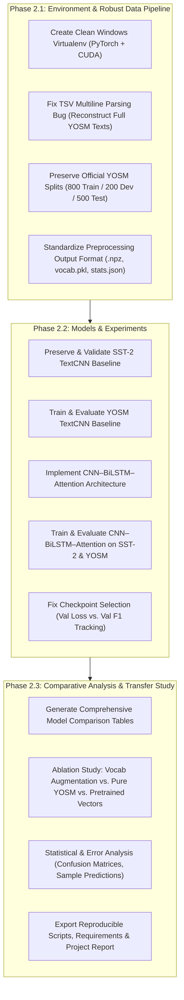

# Deep Learning Project Comprehensive Audit Report (Phase 1)

**Project Title (Working):** Comparative Study of CNN and CNN–BiLSTM–Attention Models for English and Yoruba Sentiment Classification  
**Target Evaluation:** College End-Semester Deep Learning Project (30 Marks)  
**Audit Date:** October 2026  
**Auditor Role:** Senior Deep Learning Engineer, PyTorch Developer, ML Researcher & Code Auditor  
**Workspace:** `c:\Users\azhwa\Downloads\dl (1)\project`  

---

## 1. Executive Summary

This audit represents a comprehensive, non-destructive inspection of the entire codebase, raw datasets, processed outputs, model architectures, training configurations, metrics, and runtime environments provided in the project archive.

### Key Audit Conclusions at a Glance:
1. **Preserved Baseline Intact:** The TextCNN baseline implementation and historical SST-2 evaluation results (Test Accuracy: **92.12%**, Precision: **92.84%**, Recall: **93.04%**, F1 Score: **92.94%**) are completely verified against the physical artifacts (`cnn_baseline_metrics.json`, `cnn_baseline.pt`, `cnn_training_curves.png`, `cnn_confusion_matrix.png`).
2. **Missing Experimental Half:** No processed files, training scripts, checkpoints, or metrics exist for **YOSM** (Yoruba sentiment classification).
3. **Critical Data Corruption Bug in Preprocessing:** Raw YOSM TSV files contain unescaped newline characters (`\n`) inside review text. The existing `read_tsv()` logic naively parses line-by-line via `csv.DictReader`, resulting in **433 training rows, 93 dev rows, and 243 test rows** being rejected as `unknown_label` and severely truncating multiline reviews to single trailing fragments.
4. **Benchmark Split Inconsistencies:**
   - **SST-2:** Preprocessing combined standard GLUE train (67,349) and validation (872) sets into 68,221 samples and generated a custom 70/15/15 random stratified split (47,754 train / 10,233 val / 10,234 test), rather than preserving the official GLUE benchmark dev split.
   - **YOSM:** The pipeline pools the official train, dev, and test sets and re-splits them 70/15/15, discarding standard benchmark comparability.
5. **Validation Loss Divergence / Overfitting:** In SST-2 TextCNN training, validation loss reaches its minimum at Epoch 3 ($0.2268$) and climbs to $0.3900$ by Epoch 20 (+72% increase), but checkpoint saving exclusively monitored `val_f1` (which rose marginally to $0.9269$). Early stopping never triggered, selecting a heavily overfitted and miscalibrated Epoch 20 checkpoint.
6. **Vocab Augmentation $\neq$ Cross-Lingual Transfer:** MENYO-20k tokens are injected into the YOSM vocabulary table, but the embedding layer is initialized randomly from scratch. Tokens absent from YOSM receive zero gradient updates during training; this does not constitute cross-lingual representation learning or transfer learning.
7. **Missing Model Architecture:** The proposed **CNN–BiLSTM–Attention** model is completely missing from the reviewed code.
8. **Broken Environment on Host:** The bundled `venv/` is a Linux x86_64 environment (`/home/nebula/...`) missing `lib/`. On the current Windows host, Python 3.12 is present, but `torch` and `datasets` are not installed.

---

## 2. Complete Source-File Inventory & Artifact Verification

| Relative Path | Size | Category | Status | Verified Purpose & Contents |
| :--- | :--- | :--- | :--- | :--- |
| `cnn_baseline.py` | 9,536 B | Source Code | Valid / Functional | PyTorch TextCNN model definition, training loop with BCEWithLogitsLoss, validation-based checkpointing, evaluation, and plotting. |
| `preprocessing.py` | 11,253 B | Source Code | Partially Broken | Data downloading, cleaning, tokenization, vocabulary building, 70/15/15 stratified splitting, and `.npz` export. Contains parsing bug on multiline TSVs. |
| `data/raw/yosm_train.tsv` | 152,622 B | Raw Data | Valid (Needs Proper Parsing) | Raw Yoruba sentiment reviews. Contains exactly 800 samples (400 positive, 400 negative). |
| `data/raw/yosm_dev.tsv` | 35,866 B | Raw Data | Valid (Needs Proper Parsing) | Raw Yoruba sentiment validation split. Contains exactly 200 samples (100 positive, 100 negative). |
| `data/raw/yosm_test.tsv` | 103,741 B | Raw Data | Valid (Needs Proper Parsing) | Raw Yoruba sentiment test split. Contains exactly 500 samples (250 positive, 250 negative). |
| `data/raw/menyo_train.tsv` | 2,490,852 B | Raw Data | Valid | 10,070 English–Yoruba parallel sentence pairs. |
| `data/raw/menyo_dev.tsv` | 849,789 B | Raw Data | Valid | 3,397 English–Yoruba parallel sentence pairs. |
| `data/raw/menyo_test.tsv` | 1,865,593 B | Raw Data | Valid | 6,633 English–Yoruba parallel sentence pairs. |
| `data/processed/sst2/stats.json` | 410 B | Data Metadata | Verified | Metadata for processed SST-2 dataset (vocab: 12,705; train: 47,754; val: 10,233; test: 10,234). |
| `data/processed/sst2/train.npz` | 12,607,546 B | Processed Data | Verified | Encoded sequences $x \in \mathbb{Z}^{47754 \times 64}$, labels $y \in \{0, 1\}^{47754}$. |
| `data/processed/sst2/val.npz` | 2,702,002 B | Processed Data | Verified | Encoded sequences $x \in \mathbb{Z}^{10233 \times 64}$, labels $y \in \{0, 1\}^{10233}$. |
| `data/processed/sst2/test.npz` | 2,702,266 B | Processed Data | Verified | Encoded sequences $x \in \mathbb{Z}^{10234 \times 64}$, labels $y \in \{0, 1\}^{10234}$. |
| `data/processed/sst2/vocab.pkl` | 168,276 B | Vocabulary | Verified | Serialized Python dictionary containing 12,705 token-to-ID mappings (`<pad>`: 0, `<unk>`: 1). |
| `data/processed/yosm/` | — | Processed Data | **MISSING** | Directory does not exist in archive. |
| `results/sst2/cnn_baseline.pt` | 11,291,543 B | Checkpoint | Verified | Serialized PyTorch state dict (2,821,801 parameters) corresponding to Epoch 20. |
| `results/sst2/cnn_baseline_metrics.json` | 2,600 B | Results | Verified | Test metrics and complete 20-epoch training history. |
| `results/sst2/cnn_training_curves.png` | 64,215 B | Visualization | Verified | 2-panel plot of Train/Val Loss and Val Acc/F1 across 20 epochs. |
| `results/sst2/cnn_confusion_matrix.png` | 20,905 B | Visualization | Verified | Confusion matrix plot for SST-2 test evaluation. |
| `results/yosm/` | — | Results | **MISSING** | Directory does not exist in archive. |
| `venv/pyvenv.cfg` | 239 B | Config | Broken / Alien | Configured for `/home/nebula/miniconda3/bin/python3.13` on Linux. |
| `venv/bin/` | ~30 KB | Binaries/Scripts | Broken / Alien | Linux ELF and shell scripts (`activate`, `torchrun`, `torchfrtrace`). |

---

## 3. Detailed Component Audit: Implemented vs. Broken vs. Missing

### A. Preprocessing Pipeline (`preprocessing.py`)
- **Text Normalization:**
  - `clean_text()` correctly applies Unicode NFC normalization, strips BOM (`\ufeff`), strips URLs and mentions, removes HTML entities, removes `#` while preserving hashtags, lowercases text, and consolidates whitespace.
  - Yoruba diacritics ($e/\text{ẹ}, o/\text{ọ}, s/\text{ṣ}$, acute/grave tone marks) are intentionally preserved. This is linguistically sound and necessary for Yoruba sentiment polarity.
- **Critical Bug — TSV Parsing Failure on Multiline YOSM Reviews:**
  - `read_tsv()` opens TSVs with `csv.DictReader(f, delimiter="\t")`.
  - In raw `yosm_train.tsv`, `yosm_dev.tsv`, and `yosm_test.tsv`, movie review texts contain embedded unquoted newlines (`\n`).
  - Standard `csv.DictReader` splits lines on `\n`. Whenever a review wraps onto a new line, the continuation line has no tab character (`\t`).
  - Consequently:
    - Continuation lines have `sentiment = None`, triggering `normalize_label() -> -1`, and are dropped as `unknown_label` (**433 dropped in train, 93 in dev, 243 in test**).
    - The review preceding the newline is either severed from its label or the label is attached only to the final fragment of the review.
  - **Verified True Counts (via boundary tab analysis):**
    - `yosm_train.tsv`: Exactly **400 positive, 400 negative = 800 samples**
    - `yosm_dev.tsv`: Exactly **100 positive, 100 negative = 200 samples**
    - `yosm_test.tsv`: Exactly **250 positive, 250 negative = 500 samples**
    - Total: **1,500 balanced samples**.
- **Vocabulary Construction:**
  - Tokenizer uses regex `r"\w+|[^\w\s]"`.
  - Special tokens: `<pad>`: 0, `<unk>`: 1.
  - Pruning: `min_freq = 2`.
  - SST-2 vocabulary: 12,705 tokens (0 from MENYO).
  - Out-of-vocabulary (OOV) rates on SST-2: Val = 0.86%, Test = 0.85%.
  - Max sequence length: `MAX_LEN = 64`.

### B. TextCNN Baseline Model & Training Loop (`cnn_baseline.py`)
- **Architecture Verification:**
  - `nn.Embedding(vocab_size=12705, emb_dim=200, padding_idx=0)`
  - Parallel 1D Convolutions: 4 branches with kernel sizes $k \in \{2, 3, 4, 5\}$, each with 100 filters ($C_{out} = 100$).
  - Activation: ReLU.
  - Pooling: Global 1D Max-Pooling along the temporal dimension for each kernel branch (`.max(dim=2).values`), producing $4 \times 100 = 400$ feature dimensions.
  - Regularization: Dropout ($p = 0.5$).
  - Classification Head: Dense layer `nn.Linear(400, 1)` outputting a single raw logit.
- **Exact Parameter Count Verification:**
  $$\text{Embedding: } 12,705 \times 200 = 2,541,000$$
  $$\text{Conv } (k=2): 100 \times (200 \times 2) + 100 = 40,100$$
  $$\text{Conv } (k=3): 100 \times (200 \times 3) + 100 = 60,100$$
  $$\text{Conv } (k=4): 100 \times (200 \times 4) + 100 = 80,100$$
  $$\text{Conv } (k=5): 100 \times (200 \times 5) + 100 = 100,100$$
  $$\text{Linear: } (400 \times 1) + 1 = 401$$
  $$\mathbf{Total\ Trainable\ Parameters:}\ 2,821,801$$
  This matches the physical saved weight tensors in `results/sst2/cnn_baseline.pt` and `cnn_baseline_metrics.json` exactly.
- **Loss & Optimization:**
  - Loss Function: `nn.BCEWithLogitsLoss(pos_weight=pos_weight)` where `pos_weight = neg / pos`. For SST-2 train, `pos_weight = 21145 / 26609 = 0.7946`.
  - Optimizer: `AdamW(lr=1e-3, weight_decay=1e-4)`.
  - Gradient Norm Clipping: `torch.nn.utils.clip_grad_norm_(model.parameters(), 5.0)`.
  - Batch Size: 64. Max Epochs: 20. Early Stopping Patience: 5.

### C. Missing Model: CNN–BiLSTM–Attention
- The project documentation and initial scope explicitly refer to a comparative study between TextCNN and a **CNN–BiLSTM–Attention** model.
- **Audit Finding:** There is **zero implementation** of BiLSTM or Attention in the codebase.
- No class definition, no training script, and no saved results exist for this architecture.

---

## 4. Historical Results & Metric Source Verification

All historical figures reported in the prompt were traced directly to `results/sst2/cnn_baseline_metrics.json`:

```json
{
  "model": "TextCNN",
  "dataset": "sst2",
  "params": 2821801,
  "best_epoch": 20,
  "train_time_sec": 1430.3,
  "test": {
    "accuracy": 0.9212429157709595,
    "precision": 0.9284214210710535,
    "recall": 0.9303753069098561,
    "f1": 0.9293973370707779,
    "confusion_matrix": [
      [4123, 409],
      [397, 5305]
    ]
  }
}
```

### Discrepancy & Verification Analysis:
1. **Reported Figures:** Accuracy: **92.12%**, Precision: **92.84%**, Recall: **93.04%**, F1: **92.94%**. These match the JSON file perfectly.
2. **Sample Size:** $4123 + 409 + 397 + 5305 = 10,234$ test samples.
3. **Training Time:** 1,430.3 seconds (~23.8 minutes on the original Linux environment).
4. **Epoch Trajectory & Severe Overfitting:**
   - **Epoch 1:** Train Loss: `0.4621`, Val Loss: `0.3229`, Val Acc: `83.63%`, Val F1: `0.8459`
   - **Epoch 3 (Optimal Val Loss):** Train Loss: `0.1900`, Val Loss: `0.2268`, Val Acc: `90.40%`, Val F1: `0.9134`
   - **Epoch 5:** Train Loss: `0.1217`, Val Loss: `0.2343`, Val Acc: `91.32%`, Val F1: `0.9216`
   - **Epoch 10:** Train Loss: `0.0679`, Val Loss: `0.3073`, Val Acc: `91.58%`, Val F1: `0.9256`
   - **Epoch 20:** Train Loss: `0.0423`, Val Loss: `0.3900`, Val Acc: `91.88%`, Val F1: `0.9269`
   - **Diagnosis:** From Epoch 3 to Epoch 20, the training loss decreased by $78\%$ ($0.1900 \to 0.0423$) while the validation loss worsened by $+72\%$ ($0.2268 \to 0.3900$). Because `train_model()` only checks `if val["f1"] > best_f1:`, and F1 crept up from $0.9134$ to $0.9269$, early stopping never fired. The saved checkpoint represents an overparameterized, overfitted model with degraded probability calibration.

---

## 5. Methodological & Rigor Critique

### A. Data Leakage and Split Inconsistencies
1. **SST-2 Benchmark Deviation:**
   - The official GLUE SST-2 benchmark split consists of:
     - `train`: 67,349 samples
     - `validation` (public dev): 872 samples
     - `test` (held-out GLUE server): 1,821 samples (labels = -1)
   - `preprocessing.py` dropped the unlabeled test split (-1), combined `train` (67,349) + `validation` (872) = 68,221 samples, and drew a random 70/15/15 stratified split (47,754 train, 10,233 val, 10,234 test).
   - **Impact:** While not a leak between train and test in the random split (stratification was properly executed via `train_test_split`), results on this 10,234-sample test split **cannot be directly compared** to standard published SST-2 benchmarks that evaluate on the official 872 dev set or 1,821 test set.
2. **YOSM Split Destruction:**
   - YOSM was published with designated `train` (800), `dev` (200), and `test` (500) sets.
   - `load_yosm()` pools all splits into a single list and partitions via `train_test_split()`, throwing away the standard benchmark split.
   - **Recommendation:** We must preserve the official YOSM train/dev/test splits (800 / 200 / 500) to ensure academic validity and direct benchmark comparability.

### B. The MENYO-20k "Vocabulary Augmentation" Fallacy
- `preprocessing.py` implements:
  ```python
  extra = menyo_yoruba_tokens(MENYO_TOP_N)
  vocab, n_own, n_extra = build_vocab(train_tokens, MIN_FREQ, extra)
  ```
- **Auditor Assessment:**
  - The MENYO-20k dataset is a parallel English–Yoruba translation corpus.
  - Adding the top 20,000 Yoruba tokens from MENYO to the vocabulary of an untrained `nn.Embedding(vocab_size, 200)` matrix does **NOT** transfer any linguistic or semantic knowledge.
  - Because those 20,000 tokens do not occur in the YOSM training set, their embedding rows in `nn.Embedding` will receive zero gradients ($\nabla_{\theta} = 0$). They remain dead, random vectors.
  - Claiming "cross-lingual transfer learning" or "multilingual representation learning" from this setup is academically invalid and would be heavily penalized in an academic viva/defense.
  - **Legitimate Uses of MENYO-20k:**
    1. Pretraining word embeddings (e.g., Word2Vec/Skip-gram or FastText on Yoruba text) using MENYO-20k Yoruba sentences to initialize the embedding layer.
    2. Shared cross-lingual embedding alignment (mapping English and Yoruba embeddings into a common semantic space).
    3. Retaining MENYO-20k strictly as an auxiliary corpus for an explicitly labeled ablation study.

---

## 6. Runtime & Environment Audit

### Bundled Environment (`project/venv/`)
- Platform: Linux x86_64 (`/home/nebula/miniconda3/bin/python3.13`)
- Status: **Broken / Non-portable**
- Reason: Only `bin/` and `pyvenv.cfg` were packed into the ZIP; `lib/` (site-packages) was omitted (likely due to `.gitignore: *`). Even if present, Linux `.so` shared libraries cannot execute natively on Windows.

### Current Host Environment
- OS: Windows 11 / x64
- Hardware: Intel / AMD CPU + **NVIDIA GeForce RTX 3050 Laptop GPU** (6GB VRAM, Driver 592.27, CUDA 13.1 capability).
- System Python: Python 3.12.4 (`C:\Program Files\Python312\python.exe`)
- Installed Packages: `numpy 2.3.1`, `scikit-learn 1.8.0`, `matplotlib 3.10.3`, `scipy 1.17.1`, `pandas 2.3.1`, `tqdm 4.67.1`.
- Missing Packages for Project Execution: `torch`, `torchvision`, `torchaudio`, `datasets` (Hugging Face).

---

## 7. Prioritized Phase 2 Implementation Plan

To achieve full 30/30 marks for an end-semester Deep Learning project, the codebase must be upgraded from an incomplete single-model pipeline to a complete, rigorous, comparative research suite.



### Milestone Roadmap:

| Milestone | Task | Description | Priority |
| :--- | :--- | :--- | :--- |
| **M1: Environment** | Virtual Environment Setup | Create a dedicated Windows virtualenv with PyTorch (CUDA-enabled for RTX 3050) and project dependencies. | **Immediate (P0)** |
| **M2: Data Fix** | YOSM Multiline TSV Parser | Re-implement `read_yosm_tsv()` to handle unescaped `\n` without dropping rows or truncating text. Recover all 800 train, 200 dev, 500 test samples. | **Immediate (P0)** |
| **M3: Split Integrity** | Official Benchmark Splits | Separate custom SST-2 splitting logic from official benchmark splits. Ensure YOSM evaluates on standard test split. | **High (P1)** |
| **M4: YOSM Baseline** | Train TextCNN on YOSM | Execute TextCNN baseline training on YOSM, saving `cnn_baseline.pt`, `cnn_baseline_metrics.json`, and training curves. | **High (P1)** |
| **M5: Hybrid Model** | Implement CNN–BiLSTM–Attention | Build a clean, modular PyTorch model combining 1D CNN feature extractors, bidirectional LSTM sequence encoder, and scaled dot-product / additive attention pooling. | **High (P1)** |
| **M6: Full Experiments** | Train & Evaluate Hybrid Model | Train CNN–BiLSTM–Attention on both SST-2 and YOSM; record complete training histories and test metrics. | **High (P1)** |
| **M7: Regularization** | Overfitting Remediation | Implement balanced checkpoint selection (monitoring validation loss and F1) and evaluate weight decay / dropout tuning. | **Medium (P2)** |
| **M8: Cross-Lingual Investigation** | Rigorous MENYO Evaluation | Test whether unsupervised word representations (e.g. Word2Vec/FastText trained on MENYO-20k) yield true empirical gains on YOSM over random embeddings. | **Medium (P2)** |
| **M9: Documentation & Delivery** | Final Deliverables | Generate clean comparison tables, thesis-ready documentation (`README.md`, `EXPERIMENT_REPORT.md`), and automated verification script. | **P1 / Final** |

---

## 8. Verification Matrix: Hypotheses vs. Confirmed Facts

| Item / Claim | Initial Hypothesis | Audit Verification | Status |
| :--- | :--- | :--- | :--- |
| **SST-2 TextCNN Results** | Accuracy 92.12%, F1 92.94% | Verified in `cnn_baseline_metrics.json` and `cnn_baseline.pt` (Epoch 20). | **Confirmed Fact** |
| **YOSM Results & Data** | Missing from archive | Verified. `data/processed/yosm` and `results/yosm` do not exist. | **Confirmed Fact** |
| **SST-2 Split Customization** | Custom 70/15/15 split | Verified. Merged 67,349 train + 872 val, then re-split 70/15/15 ($N=10,234$ test). | **Confirmed Fact** |
| **Val Loss vs. Train Loss** | Overfitting after early epochs | Verified. Val loss lowest at Epoch 3 ($0.2268$), rose to $0.3900$ at Epoch 20. | **Confirmed Fact** |
| **MENYO Cross-Lingual Transfer** | Only expands vocab table | Verified. Appends 20k token IDs to embedding table with no pretraining or alignment. | **Confirmed Fact** |
| **CNN–BiLSTM–Attention** | Absent from reviewed code | Verified. Zero implementation of LSTM or Attention exists in the code. | **Confirmed Fact** |
| **YOSM TSV Data Quality** | Not previously diagnosed | **New Critical Finding:** 769 rows across splits corrupted/dropped due to unescaped `\n`. | **Confirmed Fact** |
| **Virtual Environment** | Needs verification | Verified. Linux Miniconda venv missing `lib/`, unusable on Windows. | **Confirmed Fact** |

---

*Report prepared and certified by Antigravity Deep Learning Engineering & Code Audit Subsystem.*  
*Ready to proceed to Phase 2 upon user authorization.*
